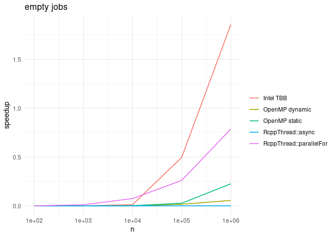
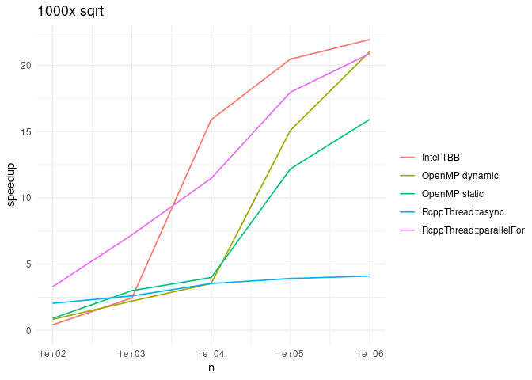
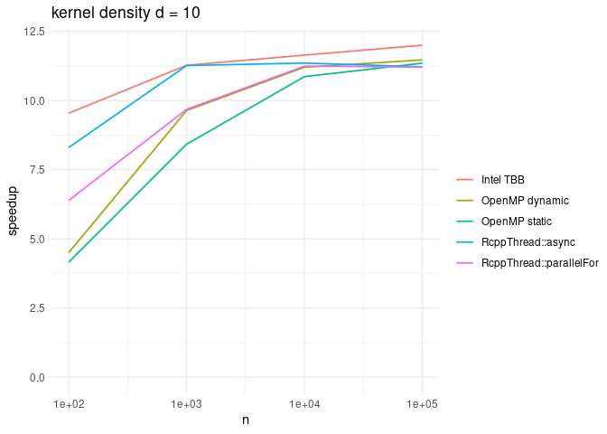
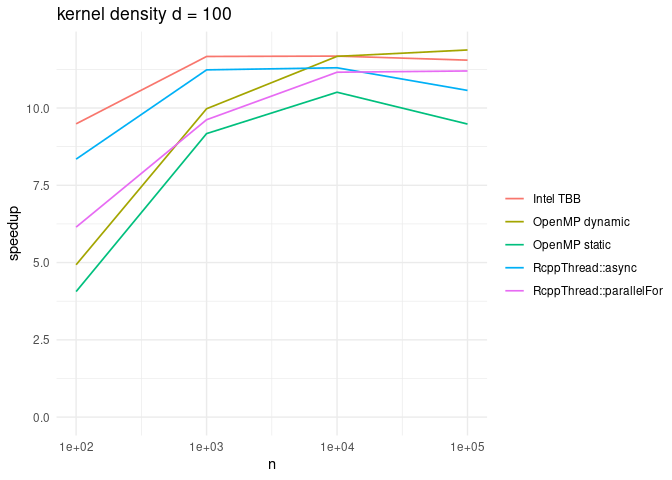
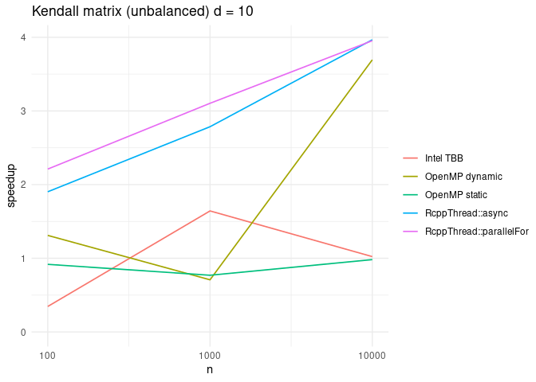
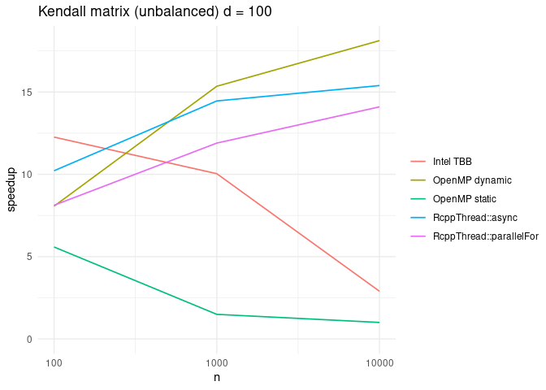

Graphs show speedup over single-threaded execution (higher is better)

#### Libraries

    library("ggplot2")
    library("dplyr")
    library("tidyr")
    library("Rcpp")
    library("RcppParallel")
    library("RcppThread")

#### Utilities

    Rcpp::sourceCpp(here::here("benchmarks/benchmarks.cpp"))

    ##  -latomic -lpthread

    wait_for <- 5

    plot_df <- function(df, title = NULL) {
      p <- df %>%
        pivot_longer(-n, names_to = "call") %>%
        ggplot(aes(n, value, color = call)) +
        geom_line(size = 0.6) +
        expand_limits(y = 0) +
        labs(color = "") +
        theme_minimal() +
        theme(legend.margin = margin(1, 1, 1, 1)) +
        scale_x_log10() +
        ylab("speedup") +
        labs(title = title)
      print(p)
    }

## Benchmarks

### empty threads

    ns <- 10^(2:6)
    res <- benchEmpty(rev(ns), wait_for)
    df <- cbind(data.frame(n = rev(ns)), as.data.frame(res[, -1]))
    plot_df(df, "empty jobs")

    ## Warning: Using `size` aesthetic for lines was deprecated in ggplot2 3.4.0.
    ## ℹ Please use `linewidth` instead.
    ## This warning is displayed once per session.
    ## Call `lifecycle::last_lifecycle_warnings()` to see where this warning was
    ## generated.

    ggsave(here::here("benchmarks/benchEmptyThread.pdf"), width = 7.5, height = 3)

### compute 1000 square roots per thread

    ns <- 10^(2:6)
    res <- benchSqrt(rev(ns), wait_for)
    df <- cbind(data.frame(n = rev(ns)), as.data.frame(res[, -1]))
    plot_df(df, "1000x sqrt")

    ggsave(here::here("benchmarks/benchSqrt.pdf"), width = 7.5, height = 3)

### kernel density estimation (d = 10)

    ns <- 10^(2:5)
    res <- benchKDE(rev(ns), 100, wait_for)
    df <- cbind(data.frame(n = rev(ns)), as.data.frame(res[, -1]))
    plot_df(df, "kernel density d = 10")

    ggsave(here::here("benchmarks/benchKDE-10.pdf"), width = 7.5, height = 3)

### kernel density estimation (d = 100)

    ns <- 10^(2:5)
    res <- benchKDE(rev(ns), 100, wait_for)
    df <- cbind(data.frame(n = rev(ns)), as.data.frame(res[, -1]))
    plot_df(df, "kernel density d = 100")

    ggsave(here::here("benchmarks/benchKDE-100.pdf"), width = 7.5, height = 3)

### Kendall matrix (d = 10, imbalanced)

    ns <- 10^(2:4)
    res <- benchKendall(rev(ns), 10, wait_for)
    df <- cbind(data.frame(n = rev(ns)), as.data.frame(res[, -1]))
    plot_df(df, "Kendall matrix (unbalanced) d = 10")

    ggsave(here::here("benchmarks/benchKendall-10.pdf"), width = 7.5, height = 3)

### Kendall matrix (d = 100, imbalanced)

    ns <- 10^(2:4)
    res <- benchKendall(rev(ns), 100, wait_for)
    df <- cbind(data.frame(n = rev(ns)), as.data.frame(res[, -1]))
    plot_df(df, "Kendall matrix (unbalanced) d = 100")

    ggsave(here::here("benchmarks/benchKendall-100.pdf"), width = 7.5, height = 3)
